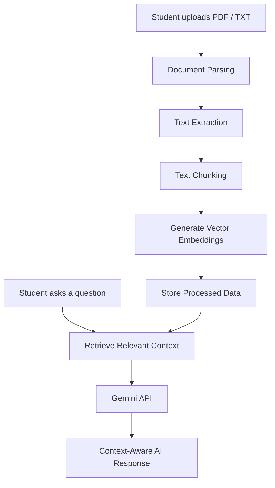

# 🧭 Udaan AI — Personalized Career & Counselling Guide

\<p align="center">
&#x20; \
\</p>

\<h3 align="center">Navigate the chaos of college admissions and career decisions with AI.\</h3>

\<p align="center">
&#x20; An AI-powered platform designed to help students make informed decisions about college admissions, career paths, and academic planning.
\</p>

---

## 🚀 Key Features

- **📄 Intelligent Marks & Document RAG:** Upload marksheets, rank cards, or college cutoff documents in PDF or TXT format. Udaan AI processes these documents, generates vector embeddings, and answers questions based on the uploaded information and student scores.

- **💬 Dynamic Interactive Chat:** Create new chat threads, pin important conversations, and rename sessions using the intuitive inline editing feature.

- **📊 Student Analytics & Planner:** An integrated dashboard displaying college preferences, budget considerations, admission cutoffs, and mock schedules.

- **❤️ Empathy & Stress Detection:** Sentiment analysis monitors stress-related signals in conversations and adapts the interface to provide a warmer, more supportive experience.

- **🎨 Modern Sky-Blue UI:** A redesigned light-blue interface featuring an expandable sidebar, responsive layouts, smooth transitions, and interactive micro-animations.

---

## 🛠️ Tech Stack

| Category            | Technologies                                      |
| ------------------- | ------------------------------------------------- |
| Frontend            | React, Vite, Tailwind CSS                         |
| Backend             | Node.js, Express.js                               |
| Database            | MongoDB                                           |
| AI Integration      | Google Gemini API                                 |
| Document Processing | PDF/TXT parsing, text chunking, vector embeddings |
| UI & Styling        | Tailwind CSS, Responsive Design                   |

---

## 📐 How It Works — RAG Architecture

Udaan AI uses Retrieval-Augmented Generation (RAG) to provide answers grounded in the documents uploaded by students.



### RAG Workflow

1. **Document Upload:** Students upload marksheets, rank cards, or college cutoff documents.
2. **Text Extraction:** The application extracts relevant information from the uploaded files.
3. **Chunking & Embeddings:** Extracted text is divided into smaller chunks and converted into vector embeddings.
4. **Context Retrieval:** Relevant information is retrieved based on the student's question.
5. **AI Response:** Gemini uses the retrieved context to generate relevant, document-grounded answers.

---

## 📦 Local Installation

Follow these steps to run Udaan AI on your local machine.

### Prerequisites

- Node.js and npm
- MongoDB connection (local or MongoDB Atlas)
- Google Gemini API key
- Git


### 1. Configure Environment Variables

Create a `.env` file inside the `backend/` directory.

```env
PORT=5000
MONGO_URI=your_mongodb_connection_string
JWT_SECRET=your_jwt_secret
GEMINI_API_KEY=your_gemini_api_key
FRONTEND_URL=http://localhost:3000
```

Replace the placeholder values with your actual credentials.

### 2. Run the Backend Server

Open a terminal and execute:

```bash
cd backend
npm install
npm run dev
```

### 3. Run the Frontend Application

Open a second terminal:

```bash
cd frontend
npm install
npm run dev
```

Visit the local frontend URL shown in your terminal (expected to be `http://localhost:3000` if configured accordingly).

---

## 🌐 Production Deployment

Udaan AI can be deployed using Render.

For production deployment:

- Deploy the backend as a Render Web Service.
- Deploy the frontend as a Render Static Site.
- Configure the required environment variables in the respective services.
- Set `FRONTEND_URL` in the backend configuration.
- Set `VITE_API_URL` in the frontend configuration to point to the deployed backend API.

Ensure that the frontend and backend URLs are configured correctly before using the production application.

---

## 🎯 Project Objective

Udaan AI aims to simplify the college admission journey by combining AI-powered document understanding, personalized counselling, student analytics, and interactive planning tools in one platform.

The goal is to help students move from confusion to clarity and make more informed academic and career decisions.

---

\<p align="center">   \<b>Built with ❤️ to help students find their direction.\</b> \</p>
